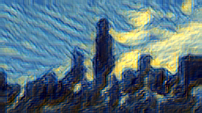
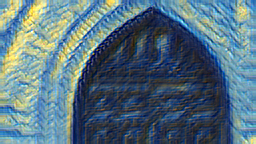
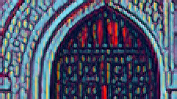
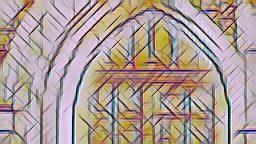
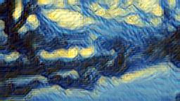
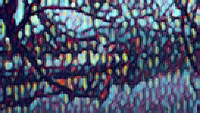
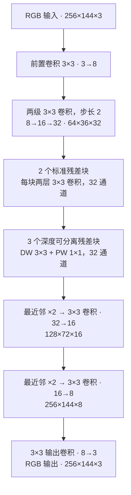

# Ti60 四风格实时视频风格迁移工程

唯一Efinity入口：[hardware/ti60f225_oob.xml](hardware/ti60f225_oob.xml)。

## 风格推理展示

| 原图 | 星空 | 立体派 | 抽象派 | 马赛克 |
|---|---|---|---|---|
|  |  |  |  |  |
|  |  |  |  |  |
|  |  |  |  |  |

从上到下是城市天际线、石拱门和水乡。每行使用同一张 256×144 输入图，在软件 INT8 参考模型中运行当前部署权重，展示三组历史 IN 调度下重复输入同一图像的第 45 帧输出。星空、立体派和马赛克引用交付包中的历史 IN 验证图。抽象派使用当前联合固件中的兼容权重和 IN 参数，按相同设置重新推理。[模型与验证说明](models/deployed/README.md)

## 功能与操作

SC431HAI摄像头1280×720@60输入，经去马赛克、固定白平衡和缩放后，将864×486原画存入DDR。CNN以256×144输入/输出，在225MHz域按严格gap9节拍处理。HDMI默认720p，网络外缩放均使用双线性插值。

| 按键 | FPGA GPIO | 功能 |
|---|---|---|
| 按键1 | GPIOL_07 | 暂停/继续显示 |
| 按键2 | GPIOR_22 | 分屏/风格全屏切换 |
| 按键3 | GPIOR_21 | 星空→立体派→抽象派→马赛克循环切换 |

按键低电平有效，共用1ms采样与21次稳定判定消抖。分屏为左原画、右风格，两幅640×360居中，上下留黑；全屏将风格图双线性放大到1280×720。右上角显示CAM/CNN两位实测帧率，LED指示初始化状态。

## 当前网络

共16层卷积、15处IN；IN使用三组历史统计和软核后台系数更新。网络内上采样为最近邻，网络外显示为双线性。组件结构、逐层并行度、分时调度、IN/权重及DDR组织见[硬件加速器详解](hardware/README.md)。移植到Xilinx等平台见[跨平台适配指南](docs/porting.md)。

**权重说明：**星空、立体派、马赛克、抽象派四风格实际加载数据见`weights/runtime`，完整模型交付包见`models/deployed`，来源和哈希见[config/deployed_models.json](config/deployed_models.json)。原训练资料在`models`各风格目录。

## 资源与验证

| XLR | RAM | DSP | setup WNS | hold WNS |
|---:|---:|---:|---:|---:|
| 59,684 / 60,800 | 245 / 256 | 119 / 160 | +0.048ns | +0.024ns |

这是随附BIT对应的Efinity 2026.1.132、Ti60F225/I3报告。

## 文件组织

| 目录 | 内容 |
|---|---|
| `hardware/` | 唯一Efinity工程、RTL、IP、约束、软核应用和构建报告 |
| `firmware/` | 可直接烧录的联合HEX及校验信息 |
| `software/cnn_boot_soc/` | 软核共用BSP、驱动与启动代码 |
| `weights/runtime/` | 当前四套63296B权重扫描包及3200B IN表 |
| `weights/<风格>/` | 原训练模型导出资料，区别于当前运行包 |
| `models/` | 原训练源码、模型权重、新硬件网络定义及复现限制 |
| `data/` | 外部训练数据的放置说明，不含完整数据集 |
| `docs/` | 复现与移植指南、主页展示用输入图 |
| `config/` | 当前工程/固件校验值、模型来源、工具路径 |
| `tools/` | 完整性检查、构建、模型导出工具 |
| `reports/` | 当前工程文件完整性索引 |

## 复现与下载

优先按[使用Efinity复现](docs/reproduce.md)操作。已有文件：

- [JTAG BIT](hardware/outflow/ti60f225_oob.bit)：要求Flash权重/IN与当前软核CRC一致；只改视频逻辑时可沿用同一套权重。
- [完整Flash HEX](firmware/FLASH_CNN_CAMERA_START_0x00000000.hex)：含FPGA、嵌入软核程序与四套权重/IN，从地址`0x00000000`烧录；不含静图。

运行`python tools/verify_project.py`检查路径、CPU初始化、四套权重和固件内容，不综合、不烧录。当前固件包含三套新重训模型和保留的抽象派；校验值见[config/project.json](config/project.json)。可选脚本入口为`build.ps1 -Stage check|cpu|fpga|package`，不再选择版本。

仓库包含源码、训练权重、IP 初始化和随附固件。构建目录和本机工具配置由 Git 忽略。

## 文档导航

- [硬件加速器详解](hardware/README.md)：组件、层间握手、MAC调度、缓存、IN、权重与60fps预算。
- [Efinity复现与烧录](docs/reproduce.md)：修改软核、更新CRC、重建BIT及联合HEX。
- [其他FPGA平台移植](docs/porting.md)：Xilinx原语/IP、DDR、CPU、时钟约束及验收步骤。
- [运行权重与原训练资料区别](weights/README.md) · [当前重训模型](models/deployed/README.md)。

移植文档是设计指南，仓库尚未提供已验证的Vivado工程。Ti60的资源/时序报告不能作为其他器件的性能保证。
