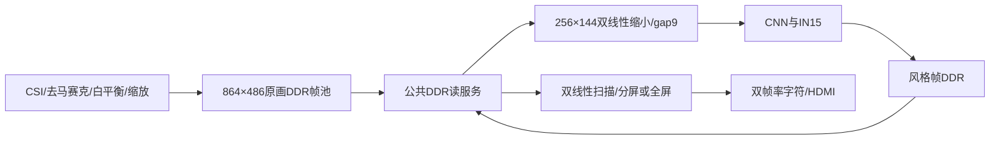

# 硬件结构与操作

工程入口：`ti60f225_oob.xml`。本版本聚焦实时摄像头采集、CNN推理、风格切换与HDMI显示。

## 保留功能

- SC431HAI输出1280×720@60，沿用当前寄存器和固定白平衡；DDR原画为864×486。
- 输入缩小到256×144，以225MHz域的严格gap9节拍进入CNN；输出仍为256×144。
- 四种风格：星空、立体派、抽象派、马赛克。上电预载到四个DDR地址段，切换时从DDR重载；外部权重格式不变。
- 按键1暂停/继续；按键2在左原画右风格的分屏与风格全屏间切换；按键3循环风格。三个按键低电平有效，保持1ms采样、21次稳定判定消抖。
- 默认HDMI720p，网络外显示放大仍为双线性。分屏为两幅640×360居中显示，上下黑边；全屏风格放大到1280×720。
- 右上角仅保留CAM和CNN两位实测帧率；保留初始化LED与JTAG。Gamma文件保留，顶层暂不实例化。

语音控制及串口引脚、静图模式及预览、第四按键、图源标签、切换毫秒计时和摄像头尺寸字符已移除。GPIOL_03、GPIOR_12、GPIOR_15不再由本版本分配。软核继续完成摄像头初始化、四风格权重加载、故障状态保持和后台IN系数更新。

## 数据流

原画只采集写入一次，CNN与HDMI共享DDR读服务和解包器，仍保留现有反压、完整帧发布及缓冲保护。删除静图后，帧池和DDR读服务只处理固定864×486输入；CNN结果写入令牌从132位减到130位，去掉的两位仅为图源标签，RGB888数据和首尾标志不变。显示与暂停请求仍经过同步器，实际换帧/布局选择保持在现有帧边界处理。

## 网络与存储组织

网络、计算位宽和IN算法未变：3→8前置卷积，stride2的8→16、16→32编码到64×36×32，两个双标准3×3残差，三个DW3×3＋PW1×1残差；之后最近邻上采样到128×72再3×3 32→16，上采样到256×144再3×3 16→8，最后3×3 8→3。共16层卷积、15处IN，仍使用三组历史统计及软核后台更新。

标准残差的四层权重主体各自独立，尾部按残差块分为两个共享池；四层共40块RAM。参数沿用公共表空位复用，共7块RAM。CNN合计150块RAM，其余逻辑95块；没有缩减输入FIFO、行缓存或跳连缓存。

每风格仍为63296B扫描权重＋3200B IN表，DDR间距128KiB，四套Flash地址保持不变。CNN计算模块、摄像头寄存器、PLL频率均未改动。Sapphire仍使用原平台实例，语音外部接口和软件解析已删除。

## 构建结果与验证

资源XLR / RAM / DSP：**59684 / 245 / 119**；setup / hold WNS：**+0.048 / +0.024ns**。setup和hold均通过当前时序约束。

CPU代码BIN为11106B，含栈RAM使用13728B，平台RAM容量为16KiB。

帧池随机暂停/换帧/故障测试、两帧完整864×486→256×144缩放、严格gap9、CNN结果写DDR背压，以及CNN与HDMI并发DDR读取，均与原版摄像头模式逐拍一致。四套实际运行权重完整写入各自DDR段，IN参数读回逐字节一致。既有CNN整数验证继续适用；本轮未上板。

[资源报告](reports/assessment.json) · [接口测试报告](reports/interface_validation.json)

## 下载与复现

[BIT](outflow/ti60f225_oob.bit)可通过JTAG临时下载；由于权重地址和内容未变，可直接使用现有Flash内的四套权重验证。

[完整Flash HEX](../firmware/FLASH_CNN_CAMERA_START_0x00000000.hex)从地址0烧录，包含FPGA配置、嵌入软核程序与四套权重/IN，已经不含静图数据；本轮没有烧录。Efinity流程见[复现说明](../docs/reproduce.md)。

当前权重仍是兼容新解码结构的测试权重，尚未针对上采样提前的新解码器重新训练。本工程只保留当前实现。
