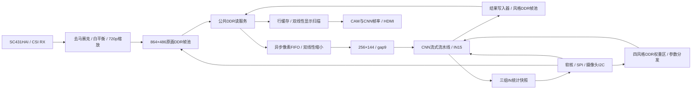

# 硬件加速器结构与工作原理

唯一工程入口：[ti60f225_oob.xml](ti60f225_oob.xml)。本文按当前有效实例和软核程序说明，不以模块的默认参数或历史注释代替顶层配置。顶层为`rtl/ti60f225_oob_top.v`，加速器源码在`rtl/cnn_accel/rtl`。

## 1. 系统边界与数据流

DDR保存原画、风格结果及四套权重，CNN内部保存行窗口、小队列、权重和参数，不把每一层完整特征图写回DDR。各卷积层有自己的计算单元并同时流水运行；每层内部再分时复用乘法器，二者共同构成当前架构。

摄像头输出1280×720@60，去马赛克与固定白平衡后缩为864×486并保存。CNN输入/输出为256×144。显示默认720p：分屏时左原画右风格，两幅640×360居中，上下黑边；全屏时风格图直接双线性插值到1280×720。网络内的两次上采样是最近邻，网络外显示和输入缩小是双线性。

三个低有效按键共用1ms采样和21次稳定判定：按键1暂停/继续，按键2分屏/风格全屏，按键3循环星空、立体派、抽象派、马赛克。保留初始化LED、JTAG与实测CAM/CNN两位帧率；语音、静图、第四按键和附加尺寸/延迟字符不在当前链路中。Gamma文件保留，但顶层未实例化。

## 2. 时钟、稀疏数据和跨域

| 域 | 当前频率 | 主要职责 |
|---|---:|---|
| `i_cam_ck_CLKOUT` | 外部摄像头提供 | CSI字节数据接收；实际频率由传感器模式决定，SDC约束不是给传感器设置频率 |
| `i_mipi_rx_pclk` | 50MHz | CSI像素输出、4像素去马赛克、白平衡和采集写入 |
| `core_clk` | 100MHz | DDR用户侧、公共读写服务、Sapphire及APB |
| `clk_225M` | 225MHz | CNN输入读端、缩小器、gap9调度、全部CNN计算和结果写入侧 |
| `CLK_25M` | 25MHz | 按键采样等板级控制 |
| `hdmi_tx_slow_clk` | 74.25MHz | 默认720p视频扫描与HDMI编码 |

CSI字节域由外部源驱动，不能因为SDC中有某个数字就把它视为已实测频率。DDR PHY校准时钟和TMDS快时钟等由Interface Designer产生，移植时须按板卡重建。

`cnn_bilinear_downscale`当前启用名为`DUAL_CLOCK`的路径，但经过同域优化后，其小图光栅也在225MHz域工作：每9拍产生一次`video_tick`，模拟25MHz像素时基。有效像素`valid`是单拍脉冲，行内相邻像素相隔9个225MHz周期；`href`维持行范围，不是每像素脉冲。不要再无条件串接旧异步视频桥，否则会多出缓存和潜在丢帧点。

顶层输入缩小配置为864×486→256×144、`INPUT_GAP=5`；这里的5是高速源读出的节流参数，不是送CNN的gap。输出光栅使用`VIDEO_HT=2000`、`VIDEO_VT=208`、`VIDEO_HA=944`、`VIDEO_VA=4`及60Hz分数帧尾。有效区外留出的时间是CNN分时计算预算的一部分。

各层内部使用`valid/ready`：仅在两者同时为1时消费一个通道组；阻塞时保持数据和状态。顶层稀疏视频没有对摄像头逐像素反压的接口，因此需要前端FIFO、完整帧计数、溢出检测和整帧中止恢复。跨域使用异步FIFO、保持数据直到确认的邮箱、事件翻转同步器，以及异步置位/同步释放复位；禁止直接跨域采样多位变化数据。

## 3. 当前网络及并行参数

IN编号0～14位于前15层卷积之后；末层RGB输出不加第16处IN。

| 卷积/IN编号 | 输出张量（W×H×C） | 运算 | GI / GO / PE | 有效调度 |
|---|---|---|---|---|
| 0 / 0：stem | 256×144×8 | 3×3，3→8 | 3 / 2 / 2 | `cnn_output_mac`，先完成一个输出组 |
| 1 / 1：enc1 | 128×72×16 | 3×3，8→16，stride2 | 2 / 2 / 2 | `cnn_dense_mac`交织输出组 |
| 2 / 2：enc2 | 64×36×32 | 3×3，16→32，stride2 | 2 / 32 / 2 | 交织计算，再拼成32通道字 |
| 3～6 / 3～6 | 64×36×32 | 两个标准残差，各两层3×3 32→32 | 2 / 2 / 4 | 每层独立MAC，尾部权重按块共享 |
| 7～12 / 7～12 | 64×36×32 | 三个DW3×3＋PW1×1残差 | DW：2通道并行；PW：2输入、1输出 | DW共享读表；PW输出通道优先 |
| 13 / 13：decode_project | 128×72×16 | 最近邻×2后，3×3 32→16 | 4 / 4 / 4 | 交织输出组，6行窗口缓存 |
| 14 / 14：decode1 | 256×144×8 | 最近邻×2后，3×3 16→8 | 4 / 2 / 4 | 交织输出组 |
| 15：head | 256×144×3 | 3×3，8→3 | 2 / 3 / 3 | 交织输出组，输出RGB |

上表参数来自`cnn_core.v`的实例；`cnn_resblock`不是一个具有统一GI/GO/PE端口的`cnn_conv`实例，其DW和PW按各自MAC配置说明。标准残差第二层输出有符号分支数据，和旁路经转换表对齐后相加。

## 4. 组件职责和层间连接

| 文件/组件 | 结构与职责 |
|---|---|
| `cnn_top.v` | 加速器系统封装；连接APB、DDR权重、IN邮箱和网络；风格切换时阻止新帧、排空并复位计算路径 |
| `cnn_core.v` | 网络拓扑、各层通道组重排、共享参数/再量化/权重服务，以及输入输出LUT和整帧控制 |
| `cnn_conv.v` | 单层参数加载→输入FIFO→窗口→MAC→量化→GO通道拼装，提供反压和故障信号 |
| `cnn_window.v` | 环形行RAM、源行保护、步长坐标与最近邻源坐标映射；所有越界坐标复制边缘（clamp） |
| `cnn_mac.v` | 标准交织MAC、输出组优先MAC、DW MAC及PW MAC；完整执行所有乘加，不按零权重跳过计算 |
| `cnn_quant.v`、`cnn_affine.v` | 参数取数、偏置/乘数/移位、IN活动与备用区、最近偶数舍入、饱和及输出通道流 |
| `cnn_requant_pipe.v` | 共享整数再量化算术流水线；请求和响应带客户端标签，乘法与舍入分级 |
| `cnn_standard_resblock.v` | 两个标准卷积、输入分叉、14位双通道旁路FIFO、残差LUT与相加 |
| `cnn_resblock.v`、`cnn_res_quant.v` | DW/PW分支、短输入队列、旁路数据保留和残差查表计算 |
| `cnn_weight_ram.v` | 权重行/成对权重封装、公共DW读表、标准卷积尾部共享池 |
| `cnn_buffer.v` | 同步RAM、RAM FIFO、短移位FIFO及参数RAM基础组件 |
| `cnn_dsp.v` | 统一乘法/累加接口；厂商原语分支和匹配延迟的通用行为分支 |
| `cnn_weights.v`、`cnn_dispatch.v` | CPU到DDR缓存、CRC回读、32位数据跨域与55段扫描分发 |
| `cnn_in.v` | 三组完整帧统计、快照、APB邮箱、运行参数更新握手 |

上游以GI通道一组输入，卷积输出先逐通道再由GO拼装；编码2和残差边界会出现256位的32通道特征字。这表示某个时刻打包了完整通道向量，不代表32通道的全部乘加在一拍内完成。`cnn_core`在这些边界负责串并转换和就绪协调。

输入FIFO容量也有不同计量单位：stem的2048项对应RGB像素；中间层16/8项是GI通道字；可分离残差的`INPUT_WORDS=32`与标准残差的`SKIP_WORDS=2560`是各自窄字FIFO，不能直接比较为像素数量。标准旁路每项存两个7位无符号通道。

## 5. 分时MAC如何计算

定义输入通道组数`NG=CI/GI`、窗口项数`NI=NG×K×K`、输出组数`NF=CO/PE`。一次MAC发射对GI个输入与PE个输出做交叉乘法，共GI×PE个标量乘积；每个输出点约需`NI×NF`次发射。

交织调度`cnn_dense_mac`中，固定输入组和核位置后，先遍历输出组，再推进输入窗口项。32→32、3×3、GI2/PE4时：一次发射算2个输入对4个输出，共8个乘积；有144个窗口项、8个输出组，共1152次发射。各输出组分别保存部分和，以换取输入样本复用。

输出组优先调度先缓存窗口，再固定输出组，遍历全部输入项形成结果，之后换输出组。stem启用`OUTPUT_STATIONARY=1`，三个可分离残差的PW启用`PW_OUTPUT_STATIONARY=1`。它减少多组部分和的同时存活，但需要保留输入窗口并处理结果背压；并非所有3×3层都已改成此调度。

当前PW32→32每个输出通道需要16个双输入发射，32个输出通道共512次。DW每组独立通道只在9个核位置累加，32通道、2通道并行约144次发射。标准MAC的`ACC_W=24`为上限，内部可按操作数和项数推导更窄的部分和；DW内部的和宽也有自己的界限。权重是有符号INT8，ReLU通道有效范围0～127，部分缓存因此压成7位；残差分支的有符号输出不能误用这种裁剪。

GI提高每次使用的输入数，PE提高同时计算的输出数，GO改变结果的拼装宽度。提高GO不会自动增加乘法器。更改GI/PE还会改变权重RAM的物理排布、读口宽度、窗口吞吐和队列压力，必须检查整除约束和完整帧。逻辑乘法数量也不等于报告里的DSP Block数量：厂商DSP的粒度和综合映射会影响计数。

## 6. 窗口、上采样与缓存保护

窗口RAM按输入行循环保存特征；读指针在核位置和输入通道组上推进。边界坐标钳制到首/末行列，实现复制填充。stride2通过输出坐标映射取样，不是任意丢弃输入`valid`。UP路径先将输出域坐标映射为最近邻源坐标，再形成3×3卷积邻域。

`WINDOW_ROWS`是流式生产/消费的保护容量，不仅是数学核高。当前decode_project保留6行，不能仅因最近邻几何上只涉及少量源行就缩至2行；上游突发和下游计算延迟可能使仍在使用的行被覆盖。三个可分离残差中，首个DW/PW块用3行，其后用2行，均以当前调度和反压为前提。

标准残差输入同时送入conv1和旁路FIFO，两支路必须共同接受一次通道组。conv2输出到达后才弹出对应旁路。FIFO余量参与`input_ready`，遇到中止清空本帧状态，不把下一帧与旧旁路相加。

## 7. 共享权重、参数与再量化

四层32→32标准3×3卷积的物理权重表各为1152行，每行8个8位权重。前1024行各层独立；末128行按同一残差块的两层组成一个共享池，共两个尾部池。请求轮转仲裁，只在尾部竞争，响应包含客户端标签并在暂停时保持。主体共32块RAM、尾部共8块，四层合计40块；有效位利用率约72%。

三个DW层的浅权重表合并，由`cnn_dw_weight_store`按时隙服务，各DW计算单元仍然独立。共享的是权重读口，不是让整个网络串行执行。是否影响实时性由请求频率、停顿和完整帧截止期决定。

公共参数表用三个20位平面读出一通道60位参数记录。第二标准残差的两层复用原客户端3的128条空记录，各占64条（32活动＋32备用），通过二选一仲裁接入既有时隙。整机量化/IN参数RAM共7块，未改变外部扫描顺序。

中间层通过`cnn_requant_pipe`使用10拍轮转算术服务；当前公共配置含10个客户端，其中有未用算术槽，第二标准残差还保留一个本地10拍服务供其两层使用。stem和head保留独立量化路径。不能按模块默认`CLIENTS=9`推断当前网络只有9个客户端。

基本整数关系是`q = clip(RNE((acc + bias) × multiplier / 2^shift))`。最近偶数舍入对半整数按最低位奇偶处理，负数也要保持对称规则；饱和范围由无符号激活/有符号残差决定。当前运行配置的偏置为有符号20位、乘数为正31位、移位32～47；外部字段仍按32位存储。压缩存储或更换DSP都不能改变结果。

## 8. IN15：统计与计算并行

统计入口是再量化前的卷积累加值，`cnn_quant`将原24位累加器结果送给统计端。统计器先算`z=acc >>> 8`，按通道积累`sum(z)`和`sum(z²)`；使用40位有符号和、60位平方和，并以每通道5个20位字存储，窄加法器分步更新。这样不需要存整幅特征图。

15层分为0～4、5～9、10～14三组，每组一次选择一层。ARM在帧边界启动，只有采样数量完整、没有中止的帧才能形成快照；快照保持到软核读完并释放。两个解码IN分别统计128×72=9216和256×144=36864个像素，每通道都要覆盖完整空间。

软核`cnn_in_runtime.h`轮询三组，读取快照和当前风格的每通道8字节训练参数：`gamma_q8:uint16`、`beta_q8:int16`、`eps_q16:uint32`。`cnn_in_math.h`用整数均值、二阶矩、非负方差、整数平方根和量程检查生成20位bias、31位multiplier及shift；不依赖FPU/libm。输出重新表达成上述整数仿射式，不在像素路径上逐点执行除法或平方根。

CPU将完整通道组写入备用参数区；该层在自己的帧清理边界切换活动区，避免同一层半帧使用新旧参数。更新不是全网同一拍提交：不同层可引用不同历史帧，系数的实际年龄包含五层轮换、CPU处理和等待本层边界的延迟。理想情况下每组每帧采一层，遍历五层约需五帧，但实际可能更久，不能说“永远就是前一帧”。`cnn_in_profile`保存采样帧、排队/计算时间和更新间隔，可用于实机判断。

运动时历史统计与当前场景不完全匹配，仍可能出现亮度/颜色暂态。三组调度缩短了轮换等待，不等于当前帧精确IN，也不等于五帧滑动平均；训练当前帧IN与部署历史IN之间仍存在差异。

## 9. 权重格式、DDR地址与启动切换

每风格扫描包63296B，共55段：16层各`W/A/B`三段（0～47），五个1024B残差转换表（48～52），256B输入LUT（53），128B输出LUT（54）。W按`[输出通道][输入通道][核行][核列]`顺序，DW每输出通道只含本通道的9个权重。A按通道依次存小端int32 bias、multiplier、shift；B为三个小端int32的qmin、qmax、ReLU6上限。段间按4字节对齐，不能把填充字节当参数。

残差表每块1024B包括128项shortcut转换、256项有符号branch转换及512项和到输出转换，中间未用字节由导出器填充。它用于将不同量化比例的分支对齐，不能直接省略查表相加。输入LUT将RGB888映射到网络输入量化域，输出LUT将输出量化值转为显示字节。

另外的3200B IN文件是400个训练通道×8字节，和A段中的运行仿射参数不是同一种格式。上电将扫描包和IN原样预载到DDR同一槽：前63296B为扫描数据，紧接3200B为IN。每槽间距0x20000。

| 风格/槽 | Flash W / IN地址 | DDR槽基址 | 当前来源 |
|---|---|---|---|
| 星空0 | 0x400000 / 0x420000 | 0x02000000 | 当前结构重训 |
| 立体派1 | 0x440000 / 0x450000 | 0x02020000 | 当前结构重训 |
| 抽象派2 | 0x460000 / 0x470000 | 0x02040000 | 保留原兼容测试包 |
| 马赛克3 | 0x480000 / 0x490000 | 0x02060000 | 当前结构重训 |

启动顺序：软核初始化摄像头并等待DDR校准→校验Flash的W/IN CRC→预载四个槽→选择默认槽→DDR回读扫描包并CRC检查→`cnn_dispatch`按段号广播8/32位单元→各层`loaded`与LUT就绪→接收完整输入帧→后台采样IN并更新参数。当前`CANDY_*`宏名是沿用的接口名，不能据此判断当前风格为糖果。`cnn_config.vh`先有旧格式基础值，再由有效的`CNN_STANDARD_FIRST`覆盖；以最后生效的63296B/55段配置、实例参数和运行就绪信号为准，不依据历史`TRAINED_READY`宏名判断是否已加载。

风格切换顺序：按键事件翻转同步到软核→屏蔽新CNN帧并排空/中止在途计算→确认空闲并清理分发应答状态→改变DDR槽号和预期CRC→重新回读并分发权重/IN→恢复推理。运行期不再从Flash搬一整套权重，但仍要把DDR数据装入各层本地RAM，不能描述为只改地址立即生效。旧显示帧可保持，摄像头链路不因重载被整体复位。

Flash权重是小端32位装包，分发器从低字节开始拆。视频DDR采用现有高位先出RGB流解包约定；顶层摄像头/显示接口按`{B,G,R}`接线，CNN边界转换为`{R,G,B}`。移植或PC向DDR注入图像时，必须逐像素核对通道及128位拍内顺序，不能套用权重的字节排列。

## 10. 采集与显示的公共DDR服务

`video_frame_pool`使用五个原画槽，间距0x140000，起始地址0；保护正在采集、最新完成、CNN正在读取、CNN已读完和正在显示的引用。采集写入最后一个AXI B响应后才发布完整帧；显示/CNN轮换地址，不复制整帧。五槽区域到0x00640000，不与权重区重叠。

`video_ddr_read_service`复用一个AXI128突发引擎和RGB解包器，为HDMI行缓存与CNN输入服务。HDMI有界优先，CNN按FIFO容量预留空间，用较短突发并在完整RGB组边界保存进度让出端口；同时切分4KiB边界，检查RRESP/RLAST。

`cnn_bilinear_downscale`在高速域缩小864×486，双行RAM解耦缩小生产与gap9消费。`video_frame_writer`将每16个RGB888像素写成3拍AXI128，130位令牌仅含数据和首尾标志；每项拆成两个65位FIFO字，并预留整组六个半字的空间。

结果使用三槽，当前基址为`0x01000000 + 3×RAW_STRIDE = 0x0139c000`，每槽间距0x1b000。前面的原画间隔是沿用地址组织，不代表仍重复写三份原画；原画显示直接引用公共原画帧池。只有完整且无错误的结果帧才发布，扫描器在帧边界选择结果，避免读到正在写的半帧。

`hdmi_nn_scanout`虽沿用旧文件名，当前实现是双线性扫描。它生成视频光栅并按所选布局计算源坐标，从DDR填充必要源行，做水平和垂直插值。帧率文字通过跨域状态邮箱在显示帧边界更新；CAM来自完整采集帧事件，CNN来自完整结果包事件，不是固定写60或统计HDMI刷新次数。

## 11. 60fps预算与资源取舍

225MHz、60fps的理论帧预算为3750000拍。既有完整帧测试采用3744000拍（16.64ms）间隔；测得处理3683194拍，约16.369751ms，测试预算余60806拍，约0.270ms。

以纯MAC发射量估算，编码1、编码2、每层标准残差、解码13与14均约2654208次/帧；它们在不同层实例并行执行，因此不能把各层时间直接相加。DW/PW及末层另有自己的吞吐。真实延迟还包括行窗口、共享参数/权重竞争、串并转换、量化、背压和帧尾排空，单纯比较乘法数并不能证明60fps。

| 项目 | 当前随附构建 |
|---|---:|
| XLR | 59684 / 60800 |
| RAM | 245 / 256（CNN约150，其余95） |
| DSP | 119 / 160 |
| setup / hold WNS | +0.048 / +0.024ns |
| 软核 | RV32I，代码BIN11106B，含栈RAM13728/16384B |

XLR/RAM/DSP是Ti60资源单位，不可按数字直接等价为Xilinx LUT/BRAM/DSP48。当前空间和时序余量都有限；换平台、修改并行度或缓存后要重测。上述拍数是既有仿真记录，不能替代实机连续帧验证。

## 12. 复现、状态与进一步阅读

当前星空、立体派、马赛克为2026-11-15新结构重训包，抽象派按用户选择保留旧兼容包；模型源码、IN和交付验证见[模型说明](../models/deployed/README.md)及[来源清单](../config/deployed_models.json)。交付包的原始工具/旧路径作为来源资料保存，当前工程以本目录入口为准。

最近一次联合固件已写入板卡8MiB Winbond W25Q64（JEDEC EF6017），完成全范围host回读校验，并下载同版BIT。实景效果和实际帧率仍需观察确认。详见[部署记录](../reports/deployment_update.json)、[资源报告](reports/assessment.json)、[接口验证](reports/interface_validation.json)。

- [Efinity复现与烧录](../docs/reproduce.md)
- [跨平台移植，含Xilinx适配与验收](../docs/porting.md)
- [JTAG BIT](outflow/ti60f225_oob.bit)
- [完整Flash HEX，从地址0写入](../firmware/FLASH_CNN_CAMERA_START_0x00000000.hex)
